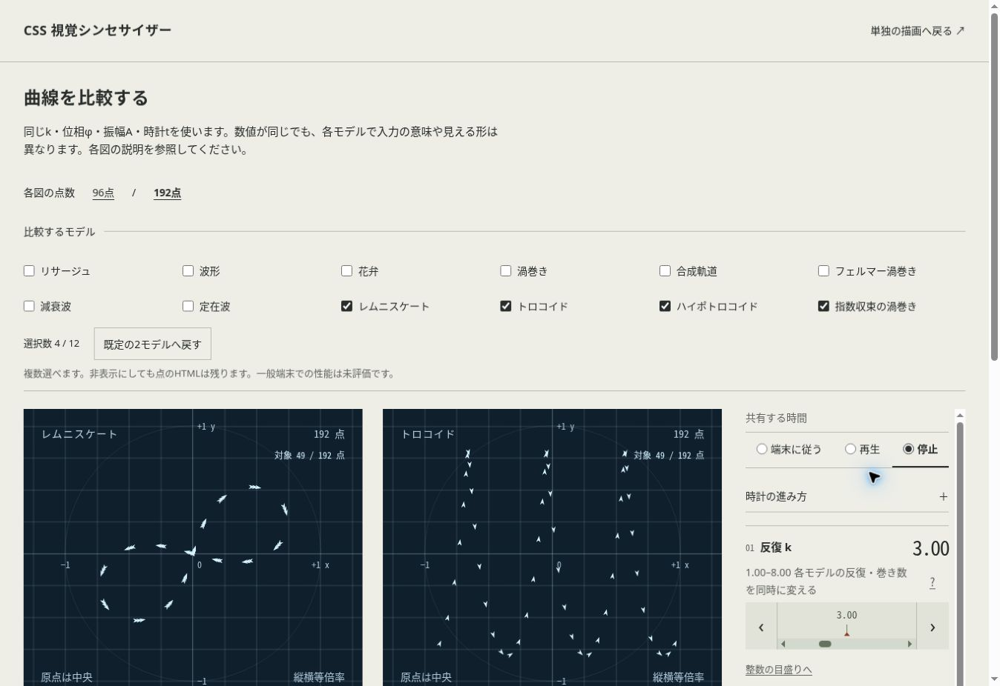

# 第5回・20件の実装記録

Issue #177〜#196、PR #197〜#216。JavaScriptを使わず、12モデル・14プリセットへ拡張する。レムニスケート、トロコイド、ハイポトロコイド、指数収束の渦巻きに座標式・MathML・接線・説明・プリセットを用意した。

比較とギャラリーで数式を開ける。点の間引き、対象点数、比較説明の短縮、192点ギャラリー、印刷条件の要約を追加した。モデル数とフィルターはレジストリーに追従する。チェックボックスは平面の6/4/2列で並ぶ。

- [検証記録](validation.md)
- [統合と修正](issue-196.md)
- [観測データ](../../qa/evidence/batch100/README.md)

各課題の要件・実装範囲は issue-177.md〜issue-196.md を参照。実機などの残課題は #3、HTML-in-Canvas APIとJSゼロの整合は #12 を継続する。
