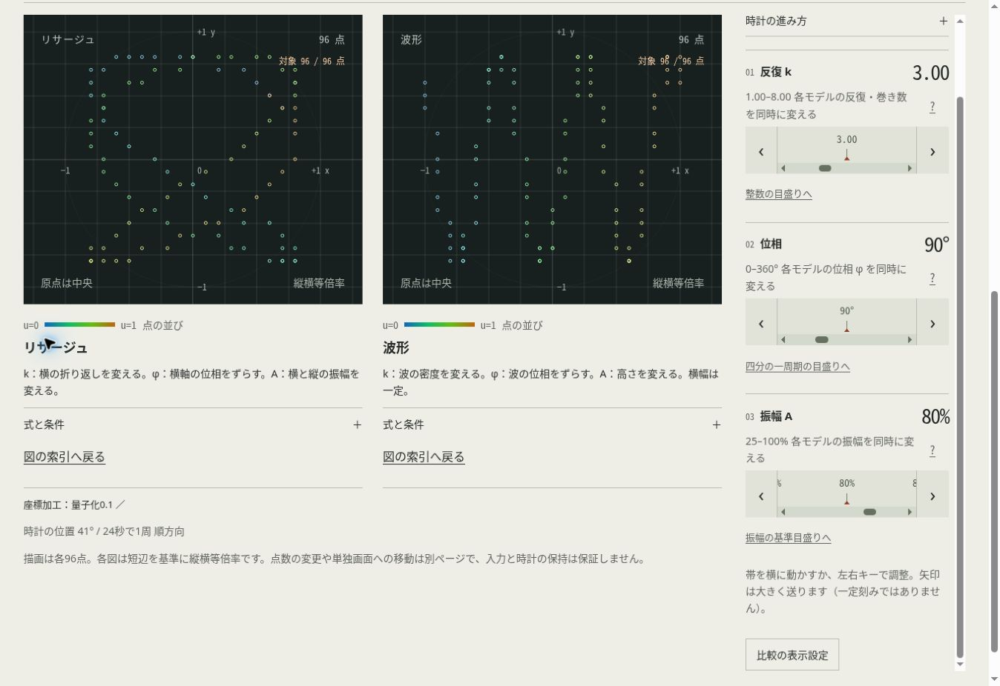

# 第6回・20件の実装記録

Issue #217〜#236／PR #237〜#256。12モデル・14プリセットを維持し、曲線の座標加工と操作の整理を進める。

| 範囲 | Issue |
| --- | --- |
| 交換・絶対値・投影・軸ゲイン・移動・量子化・単位円制限 | #217〜#223 |
| 加工順序と適用状態の画面・印刷記録 | #224 |
| 輪・符号色・点の合成・逆順色・格子間隔 | #225〜#229 |
| 表示だけのreset・用途別開閉 | #230〜#231 |
| 比較図と一覧の索引・絞り込み件数 | #232〜#234 |
| 加工座標と共有条件の独立検査 | #235 |
| 丸め境界修正・観測・CI・要件・配布統合 | #236 |

[加工の数学](processing.md)／[検証記録](validation.md)。各Issueの文書に実装範囲を記録する。JSゼロと平面のUIを維持し、HTML-in-Canvas本体 #12 と実機等 #3 は継続する。

