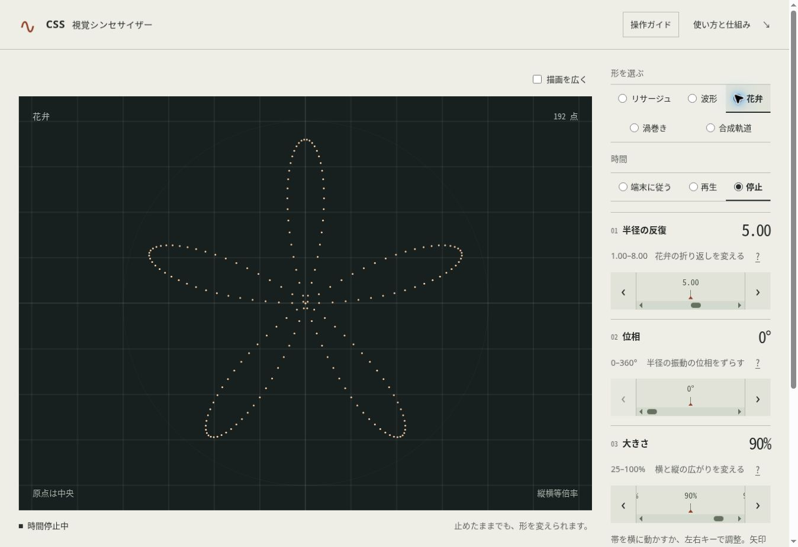
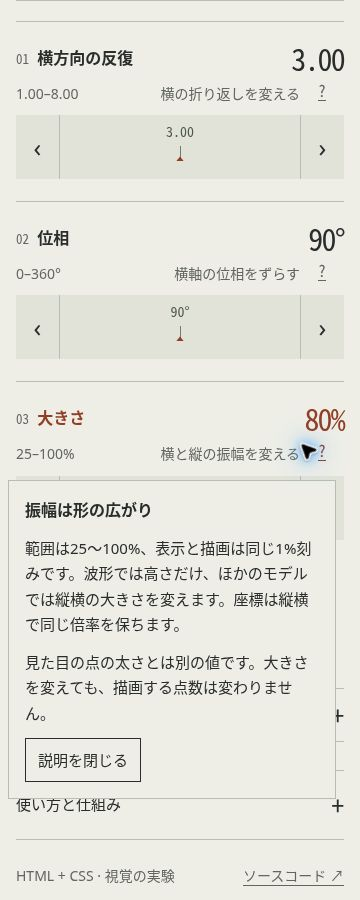

# 20件の追加実装の検証記録

検証日：2026-10-28（日本時間）。20件の実装を組み合わせた画面で観測した範囲を記録する。構文対応・静的検査・CSS fixture・実際のブラウザ操作を区別し、実機や性能の合格へ読み替えない。

## 環境と方法

| 項目 | 記録 |
| --- | --- |
| ブラウザ | Chrome 155.0.0.0 |
| UAのOS表記 | X11 / Linux x86_64 |
| viewport | 1363 × 936 CSS px |
| devicePixelRatio | 1 |
| 通常の描画領域 | 979.40625 × 708 CSS px |
| ブラウザ内の作品 | HTML / CSS。検証用のスクリプトは作品へ追加しない |

点の中心はDOMの矩形から読み取り、観測した入力・時計・描画領域とともにJSONへ保存する。Pythonの独立した数式と照合し、CSSの`--x`／`--y`を期待値には使わない。許容差は既定の0.1 CSS px。

観測JSONと画面は[`qa/evidence/batch20/`](../../qa/evidence/batch20/)に置く。model-*.json、point-*.json、mirror-xy.json、focus-*.json、preset-*.json、print.jsonは点データで、次の形式で再照合できる。表示状態のmetadata JSONは座標照合の入力ではない。

```sh
python3 -m tools.coordinates qa/evidence/batch20/model-rose.json
```

UAのOS表記は、利用者の実機・実OS設定を確認した証拠ではない。

## 5モデルの独立座標照合

反復3.00、位相90°、振幅80%、時間停止中の時計4.51514 radで、各モデルの全192点を照合した。

| モデル | 照合点数 | 最大誤差（CSS px） |
| --- | --- | --- |
| リサージュ | 192 | 0.0000478482668 |
| 波形 | 192 | 0.0000536292946 |
| 花弁 | 192 | 0.0000528397055 |
| 渦巻き | 192 | 0.0000561364809 |
| 合成軌道 | 192 | 0.0000556058575 |

今回の入力と時刻では、すべて既定の許容差以内。全パラメータ値やすべての画面比率を網羅した検証ではなく、フレーム時間・操作遅延の評価でもない。

## 表示設定

Popoverから補助線の直交・極座標・なしを選び、極座標表示と補助線を隠す状態を確認した。温色に加え、青白・紙面の配色へ切り替えられた。

点の太さは2pxと5pxを確認した。太さ変更前後の点中心の最大移動はそれぞれ0 CSS px、約0.000015258789 CSS px。左右・上下の両方を反転した状態は、反転フラグを渡した独立数式で全192点を照合し、最大誤差は約0.0000454086584 CSS pxだった。

これらは見え方の変更であり、点数やモデルの入力値を変更する操作ではない。

## ネイティブの説明と数式

操作ガイドは`commandfor`の`show-modal`で開き、ブラウザのモーダル状態となることを確認した。Escapeで閉じると呼び出しボタンへフォーカスが戻った。Dialog内の`request-close`ボタンでも閉じられた。

反復・位相・振幅の3つの説明Popoverは、デスクトップでviewport内に収まった。小画面の振幅説明は328 × 318.89 CSS px、位置はx=9、y=480.16 CSS pxで、確認した360px幅のフレーム内に収まった。これらの位置は今回の画面・文字サイズでの観測値である。

選択したモデルのMathMLラッパーが表示され、`math`のcomputed displayは`block math`だった。全モデルの式の行は13個あり、印刷用にも同じ式を生成するため、文書全体には26個の`math`要素がある。これはネイティブのレイアウト確認であり、読み上げ更新や数式ナビゲーションの実機確認ではない。

## 幅の確認

| フレームの指定幅 | clientWidth | ページの横はみ出し |
| --- | --- | --- |
| 360px | 345px | なし |
| 1280px | 1265px | なし |

360pxフレームの表示設定パネルは328 × 623.656 CSS px、位置はx=8.5、y=138.17 CSS px。内部の縦スクロールを使える範囲に収まった。

iframeによる幅確認であり、実機タッチ、モバイルブラウザの表示領域変化、OSの文字拡大を確認した結果ではない。

## 集中表示は入力と時計を保持する

既定値と異なる「5と2のリサージュ」プリセットを使用した。開始時・集中表示中・解除後のすべてで反復5.00、位相0°、振幅90%、時間停止、時計0を維持した。

描画領域は979.40625 × 708 CSS pxから1299 × 808 CSS pxへ広がり、解除後は元の寸法へ戻った。3状態とも全192点を独立照合し、最大誤差は約0.000058 CSS px以内だった。

調整欄を`display:none`にするとscroll timelineを失うため、入力のレイアウトとスクロール位置を画面外へ保持する。解除操作は描画側に残す。ブラウザの全画面モードを呼び出す機能ではない。

## 4つのプリセット

| ページ | モデル | k | 位相 | 振幅 | 時計 |
| --- | --- | --- | --- | --- | --- |
| `preset-circle.html` | リサージュ | 2.00 | 90° | 70% | 停止・0 rad |
| `preset-weave.html` | リサージュ | 5.00 | 0° | 90% | 停止・0 rad |
| `preset-two-waves.html` | 波形 | 2.00 | 180° | 60% | 停止・0 rad |
| `preset-fine-wave.html` | 波形 | 7.00 | 90° | 40% | 停止・0 rad |

各ページで上記の初期値・停止状態を観測した。HTMLに定義したラジオ状態・スクロール初期目盛り・表示値を一致させる。これは指定値で始める別ページであり、現在の操作の保存やページ移動後の状態保持を提供するものではない。

## 強制カラーと印刷はCSS分岐を確認

強制カラー用CSSを適用するfixtureでは、白背景・黒の点、横軸・縦軸の1pxの実border、グラデーション画像なしを確認した。UAが背景画像を省く環境でも、軸と基準円をborderで残す構成。実OSの強制カラー設定を使った検証ではない。

印刷用CSSのfixtureでは、描画は529.125 CSS px角（140mm指定）、印刷用の値は反復5.00・位相0°・振幅90%・時計0、操作欄は画面外の非表示、印刷用サマリーは表示状態となった。入力帯のスクロール位置1600／0／1300pxを保持し、全192点の独立照合の最大誤差は約0.0000460867876 CSS pxだった。

実際のCtrl+P操作からは、内容を確認できる印刷ダイアログを取得できなかった。実ブラウザの印刷プレビュー、PDF出力、紙への印刷は未検証。CSSを強制適用したfixtureを実際の印刷の合格にはしない。

## 機械検査の範囲

Python unittest、ビルド、HTML/CSS監査、独立座標照合、配布生成・ZIP検査を使う。検査対象は断片とモデル定義の不正、生成失敗時の前回結果保持、ネイティブ操作の参照先、改変・重複・危険なZIPエントリーなど。最終的なCIの実行先と結果は対応PRで記録する。

`:has()`が利用できない場合にも初期モデルの説明を出せるよう、生成HTMLに`data-model-initial`を付ける。これは生成内容の回帰検査を行ったものであり、古い実ブラウザを今回動かした結果ではない。

## 継続する検証

実機タッチ、実OSの動きを減らす設定・強制カラー、読み上げの更新通知・数式操作、他ブラウザ、基準端末の30秒フレーム時間と操作応答、ブラウザUIからの200%ズーム、ZIP展開後のfile://表示、実動画の24秒ループ境界、実際の印刷を[Issue #3](https://github.com/furukawa1020/CSS-Synthesizer-/issues/3)へ残す。

HTML-in-Canvasの実描画は未実施。JSゼロとの衝突とAPI採用は[Issue #12](https://github.com/furukawa1020/CSS-Synthesizer-/issues/12)で継続し、今回のHTML/CSS描画の観測をAPI検証として流用しない。

## 拡大表示と最終検査

文字200%・360px幅のfixtureで、見出しと説明ボタンが重なる不具合を検出した。ボタンを絶対配置から2列Gridへ移し、3入力すべてで重なりがなく、clientWidthとscrollWidthが345pxで一致することを確認した。これはブラウザUIの200%ズームではない。

最終の機械検査はPython unittest76件、全7HTMLと2CSSの監査、配布生成とZIP検証。各PRのCI結果を参照する。




