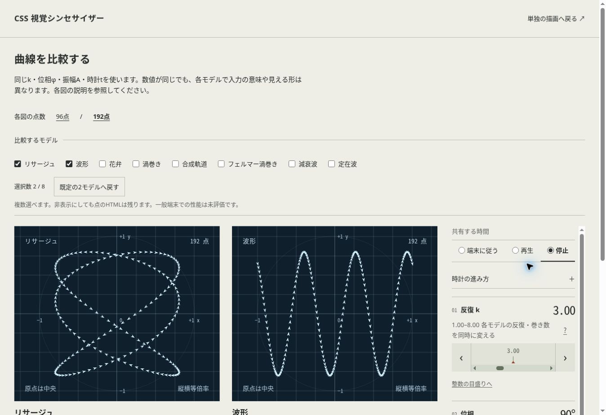

# 比較表示と時計 — 統合検証

2026-10-31（日本時間）。対象はIssue #137〜#156。実行・開発・テストはJSゼロを維持する。実装とユーザーによる個々のUI承認は別である。最終ソースの識別情報はGitHubのPRと、生成元commitを含む外部配布manifestで追跡する。

## 自動検査

Python標準ライブラリのunittest 134件が成功。生成候補監査、生成鮮度、ソース監査、21エントリーZIPと全manifest記述の照合を行う。CIは各PRの対象headで成功を確認してからmainへ統合する。

保存した今回の22ケース・2,304点を--require-allで独立式へ通した。最大座標誤差は0.011103910 CSS px、許容差0.1 CSS px。同じ22ケース・2,304点の接線のローカル方向を独立微分へ通し、最大誤差0.000499449度、許容差0.1度。接線のvisibleは疑似要素自身の塗りの有無で、範囲・不透明度による親のmaskより前を照合する。全入力の証明ではない。

## 実ブラウザの有限ケース

クラウドChrome 155.0.0.0、Linux x86_64 UA。画面はclient 1348×936 CSS px。条件は保存したlayout/checksとスクリーンショットに記録する。UAは/__qa/environmentで今回採取した。実機タッチや他OS/ブラウザではない。

| ケース | 観測 |
| --- | --- |
| 96点×8モデル | k3、φ90°、A80%、同じ時計1.93421。左右反転・45°・75%・16:9、点5px・接線・順序色・紙面・極角・範囲50%・不透明度50%・濃い補助線。全図48点の親opacityが0.5、残り0 |
| 同8モデルの別変換 | 上下も反転・90°・50%・正方形、範囲25%・不透明度25%。全図24点の親opacityが0.25、残り0。全点の座標boxは残る |
| 選択のreset | 8→既定のリサージュ/波形2つ。k3/90°/80%、停止時計1.93421、両反転等を保持。AXで選択数8/2を確認 |
| 周期/方向 | animationDurationは1s,1s,1s,12sまたは48s。directionはnormal,normal,normal,reverse。切替で時計位置が移ることも実測 |
| 逆再生 | 48秒・逆方向で再生時の時計5.31608→4.0335を記録。停止後は3.81098。全周期の精密時間測定ではない |
| 入力の独立性 | 逆方向設定のままnative linkでk8.00へ到達、φ90°/A80%を保持。その時計と変換で既定2図の全96点を照合 |
| 縦一列 | 選択2図の列が1つとなりstageが縦に並ぶ。座標は短辺基準のまま |
| 192点比較 | 既定2モデル、上下反転・180°、青白・不透明度50%・接線。共有時計0.628245。各192点とローカル接線方向を照合 |
| 単独画面 | 12秒/逆方向/停止、不透明度25%・濃い補助線。入力3/90°/80%を保持 |
| 一覧の絞り込み | 全件10、リサージュ2、波形2、残る6モデル各1。各行の既存リンク・値を保持。定在波の「値だけ」でfigureはnone、1列 |
| 幅と文字 | 360px iframeのclient/scroll345/345、1280pxでは1265/1265。360pxで文字200%も345/345。比較と一覧の通常幅に横溢れなし |
| 文字200%の極角 | 360pxの既定2図で放射ラベル0、図外凡例block・8方向。実ブラウザUIのズーム設定ではない |
| 印刷CSS fixture | rose/fermat各96点、75mm相当283.453125px正方形、t=6.28319、48秒/逆方向の保存状態。選択formはnone、共有入力のcontrolsはflex/hiddenで箱を保持。opacity25%選択でも表示範囲48点は1、残り0 |
| 強制カラーCSS fixture | opacity25%選択でも表示範囲48点は1、残り0。順序色凡例none。実OSの強制カラーではない |

## 証跡と再実行

[観測JSON](../../qa/evidence/batch80/README.md)、[操作とCSS状態](../../qa/evidence/batch80/checks.json)、[一覧](../../qa/evidence/batch80/gallery.json)、[幅](../../qa/evidence/batch80/layout.json)、[集計](../../qa/evidence/batch80/results.json)。座標はDOMのgetBoundingClientRectの中心、表示入力は登録された量子化値、時計は観測した値を使う。--x/--yを期待値として使わない。疑似要素のrotateはplotの反転・回転より前のローカル角度。

```
python3 -m tools.coordinates --batch qa/evidence/batch80/index.json --require-all
python3 -m tools.tangents --batch qa/evidence/batch80/tangents-index.json
```

選択数とresetを横並びへ整理した最終画面も再確認した。式・変換・時計の規則は上記観測と同じである。



## 継続する検証

実機タッチ、実OS、読み上げや値の更新通知、他ブラウザ、基準端末の性能、実際の印刷、file://、実UI200%ズーム、実動画の周期境界は#3で継続。CSS fixture、iframe、保存JSONのCI再照合をこれらの合格に読み替えない。HTML-in-Canvas本体は#12で継続する。
