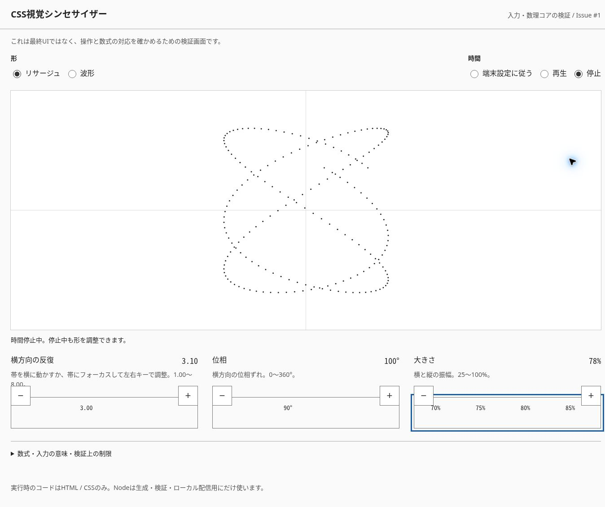

# Issue #1：入力・数理コアの検証記録

検証日：2026-10-26。対象：`src/`と`qa/`のIssue #1実装。測定値は[JSON](../../qa/evidence/core-results.json)、当時の読み取り専用の座標検査はPR #4の履歴に保存されている。現在のツリーではIssue #7により開発用JSも撤去した。

## 環境と限界

- クラウドChromeのUA：`Chrome/155.0.0.0`、`X11; Linux x86_64`。ローカル検証サーバーが実際のリクエストUAを返す`/__qa/environment`で確認。
- 基本表示領域：1348×936 CSS px。スクリーンショット取得時に1363px幅になる変化も確認した。
- CPU型番、OSの詳細、DPR、電源状態は取得していない。基準端末での性能評価ではない。
- タッチ端末、Safari/Firefox、スクリーンリーダーの音声通知、OS設定を切り替えた実際のreduced-motionは未検証。

## 座標の照合方法

時間を停止し、CSSの有効値k・位相・振幅・時間を読む。CSSの`--x`/`--y`は期待値として使わず、独立したJavaScriptの`Math.sin`で仕様の式を計算する。DOMの点の中心座標と比較する。検査点は先頭・末尾・中間を含む各ケース6点、初回の照合では8点。許容差は0.1 CSS px。

これは検証用コードであり、配布HTMLにJavaScriptは含めない。すべての時刻・すべての値を網羅したテストではない。

| ケース | 描画領域（CSS px） | 結果 |
| --- | --- | --- |
| 192点・初期値：k=3、位相90°、振幅80% | 1300×533.515625 | 検査点の最大誤差0.0079px未満 |
| 非整数k=3.10、位相100°、振幅78% | 1300×533.515625 | 最大誤差0.0079px未満 |
| 上限：k=8、位相360°、振幅100% | 1300×533.515625 | リサージュ／波形とも最大誤差0.0079px未満 |
| 下限：k=1、位相0°、振幅25% | 1300×533.515625 | 波形の最大誤差0.0079px未満 |
| 縦長領域 | 313×360 | 最大誤差0.000020px未満 |
| 横長領域 | 737×456 | 最大誤差0.000037px未満 |
| 正方形領域 | 500×500 | 最大誤差0.000022px未満 |
| 96点／384点 | 1300×533.515625 | 各最大誤差0.0079px未満。性能は測定していない |

異なる縦横比の検証はiframeと明示サイズのfixtureで実施した。スマホの実機タッチ合格を意味しない。

## 入力と表示

- 初回の値はscroll-initial-targetで3.00 / 90° / 80%に設定できた。
- kの帯にフォーカスして右キーを押し、3.10へ変化。別の帯を操作した後もその値を維持。
- 位相は100°、振幅は78%へ変更でき、k=3.10を保持した。表示のcounter値と描画に渡る有効値が一致。
- 上限・下限まで横スクロールし、値と端で無効になる生成ボタンを確認。
- 通常ページにはscript要素が0個。HTTPヘッダーとHTMLのCSPでscript-src 'none'を指定した状態で操作した。
- 表示はCSS生成テキスト。アクセシビリティツリーで数値の存在は確認できたが、読み上げが更新を通知するかは未検証。

固定値fixtureでも丸めを確認した。`k=3.09`は整数部3・小数部9を持ち、decimal-leading-zeroで2桁表示する。`k=3.999`は4.00、位相359.9°は360°、振幅99.9%は100%へ丸まり、その有効値と座標が一致した。これらは直接のユーザー入力ではなく、数値境界の検査である。

### 検証中に修正したこと

1. 近傍スナップが短いキー操作を引き戻す可能性があったため、スナップを無効化。初期位置指定は残した。
2. スクロール距離を画面幅の倍数にすると、リサイズで値が変わった。移動範囲を固定長に分離し、k=2800px、位相=1440px、振幅=1500pxとした。
3. 修正後、キャプチャ前後で画面幅が1348→1363px、描画幅が1300→1315pxと変わっても、k=3.10、位相100°、振幅78%、時間が保持された。移動範囲も一定。

## 時間停止と再開

停止中に入力を変更しても時間が保持されることを、複数の読み取りで確認。再生に切り替えると停止していた位相から進む。0へのリセット操作としては扱わない。

reduced-motionは、同じCSSのメディアクエリ部分を`@media all`に差し替えるQA専用fixtureで分岐を検査した。初期t=0で停止し、明示再生でtが進み、端末設定へ戻すとt=5.60561で停止することを確認した。**実際のOS設定変更やブラウザのメディアエミュレーションではない。**

## 再現

```sh
python3 -m tools.build
python3 -m unittest discover -s tests -v
python3 -m tools.audit
python3 -m tools.fixtures
python3 -m tools.serve
```

通常ページと`qa-frames.html`、`qa-square.html`、`qa-reduced.html`、`qa-values-fraction.html`等を開く。現在は観測した座標JSONを`python3 -m tools.coordinates`で独立照合する。fixtureは次のbuildで削除される。

ローカルの静的ガードは9テスト合格。3つのHTMLと2つのCSSを監査した。GitHub ActionsはPR作成後の実行結果を別途確認する。

## 証跡


