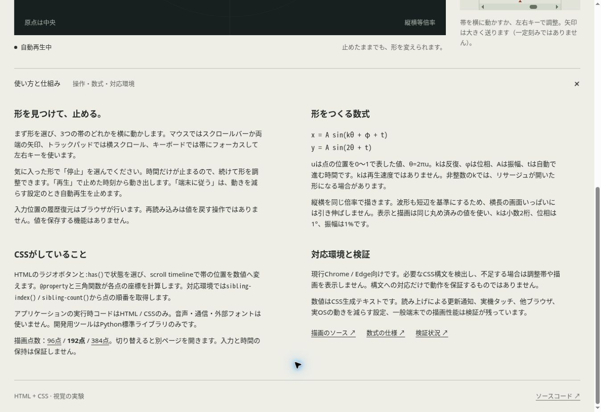
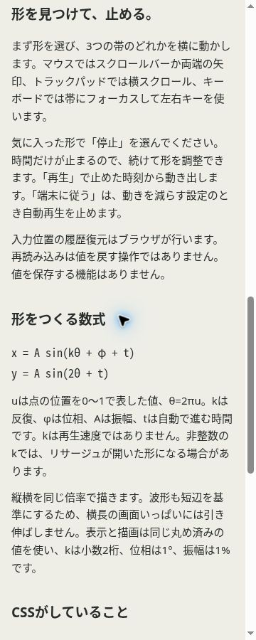

# Issue #10：付箋風の囲みを撤去

検証日：2026-10-27（日本時間）。ユーザー指定U-07に対応する表示の修正。

## 変更

数式と非対応通知の左アクセント線・字下げを削除。説明は見出しと本文の位置・余白で整理した。描画点の発光用の影、調整帯の重複した外枠も削除した。指針をAGENTSとデザインブリーフに記録し、同じ装飾を再導入しない。

## 確認

Chrome 155の通常PC表示と幅360pxのiframeで解説を開いて目視した。数式・通知のborder-inline-start-widthは0px、padding-inline-startは0px、背景は透明、影はnone。スマホ幅はscrollWidthとclientWidthがともに345pxで、横はみ出しがない。

左右キーで調整帯を操作し、入力本体の3pxのfocus-visible輪郭が表示されることを確認。追加の外枠はnone。描画点のbox-shadowもnone。通常ページのscript要素は0件。

Pythonによる生成・3 HTML / 2 CSSの静的監査を実施した。計算や入力方式は変更していない。この確認は実機タッチの評価ではない。

