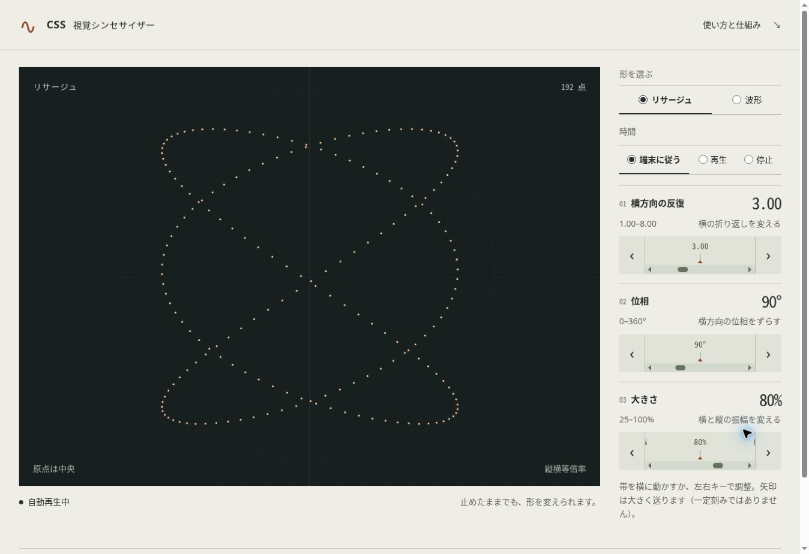
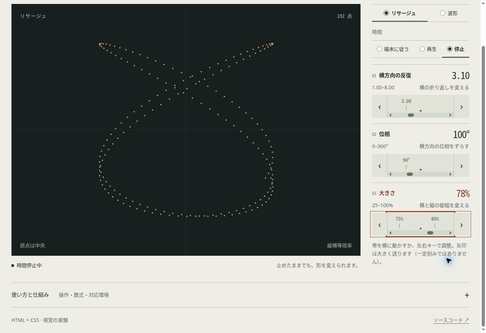
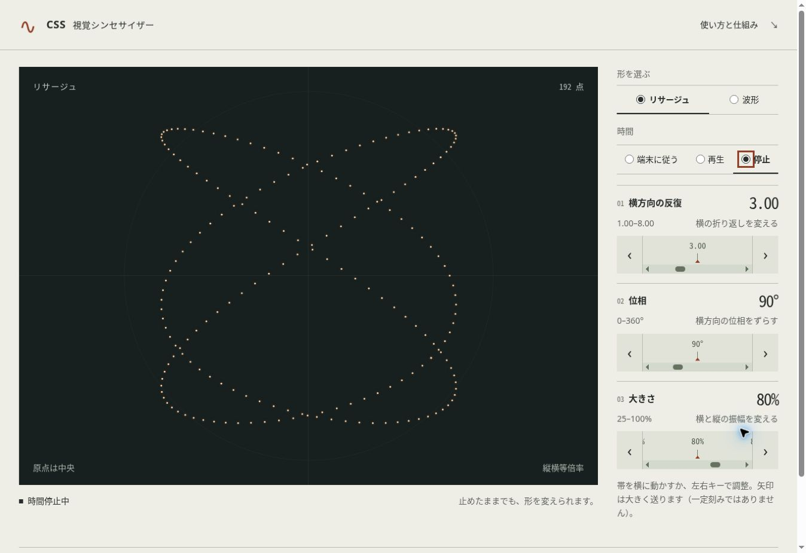
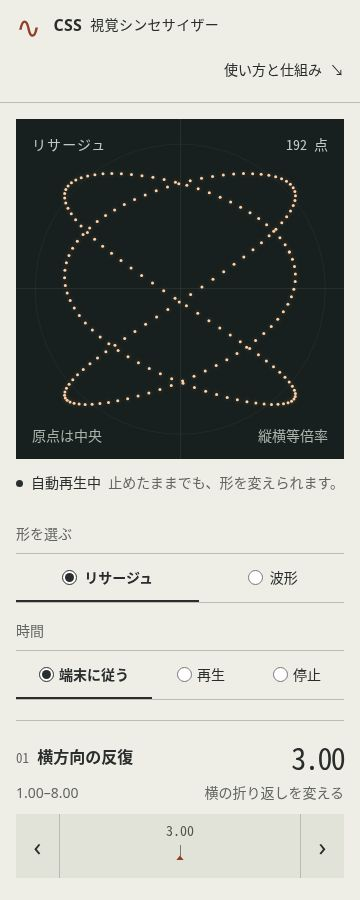

# Issue #2：作品画面と操作の検証

検証日：2026-10-27（日本時間）。クラウドChrome 155、UAのOSはLinux x86_64、DPR 1。通常の表示領域は1363×936 CSS px（縦スクロールバー分の領域を含む）。CPU・OS詳細・電源状態は不明で、性能評価には使用しない。

構成と採用理由は[ADR-0004](../decisions/0004-visual-workspace.md)、数値記録は[観測JSON](../../qa/evidence/issue-2-results.json)にある。

## 確認した操作

- ラジオボタンと左右キーで形・時間を選び、調整帯にフォーカスして各値を変更。
- 停止したt=5.69285を保持したまま、3.00 / 90° / 80%から3.10 / 100° / 78%へ調整。
- リサージュから波形に切り替え、項目名・式・描画が変わることを確認。
- detailsをSpaceで開き、モデルに対応する数式とソース・仕様・検証へのリンクを確認。
- 96点のページに移って戻ると、今回のChromeでは波形・停止・3.10 / 100° / 78%が復元。再読み込みでは3.00 / 90° / 80%と初期の選択へ戻った。復元を永続保存として保証しない。

## 座標とJSゼロ

Pythonで生成し、Pythonサーバーから配信したページでscript要素は0件。Canvas / SVG / iframe / object / embedも0件。HTMLとHTTPヘッダーのCSPでscript-src 'none'を指定したまま操作した。

実際のDOMの点の中心を観測し、Pythonのmath.sinで独立した期待座標と照合した。CSSの--x / --yは期待値として使わない。各モデル6点、許容差0.1 CSS px。

| 対象 | k / 位相 / 振幅 | 最大誤差（CSS px） | 観測値 |
| --- | --- | --- | --- |
| リサージュ | 3.10 / 100° / 78% | 0.000027922未満 | [JSON](../../qa/evidence/issue-2-coordinates-lissajous.json) |
| 波形 | 3.10 / 100° / 78% | 0.000026157未満 | [JSON](../../qa/evidence/issue-2-coordinates-wave.json) |

```sh
python3 -m tools.coordinates qa/evidence/issue-2-coordinates-lissajous.json
python3 -m tools.coordinates qa/evidence/issue-2-coordinates-wave.json
```

## レイアウト・文字・操作領域

360 / 390 / 768 / 1280 / 1440px幅のiframeで、documentElementのscrollWidthとclientWidthが一致。縦スクロールバーが出る場合の実際の内容幅は15px小さくなる。横はみ出しはなかった。これは実機タッチの検証ではない。

主要ラジオ選択肢のラベルは高さ48px以上。生成矢印は幅44px・高さ64px、入力帯の高さは64px。フォーカスを輪郭でも表示し、選択中はネイティブの選択印と下線で示す。

文字200%はhtmlのfont-sizeを200%にしたQA fixtureで、360 / 1280pxを確認した。選択肢が折り返し、入力帯が103pxに広がり、値と操作が残った。横はみ出しはない。**ブラウザUIのズーム設定を実際に200%へ変更した検証とは区別する。**

通常文字の色はWCAGの相対輝度式で照合した。紙面の本文11.98:1、補助文字5.03:1、アクセント6.18:1、帯の数字5.76:1、描画面の補助文字7.90:1。スクロールバーのつまみは背景に対して3.57:1。これだけでアクセシビリティ全体の合格を主張しない。

## 非対応表示

CSSの描画非対応分岐を強制したfixtureを360 / 1280pxで確認。描画・操作面はdisplay:none、説明はdisplay:block。狭い画面用の媒体ルールで操作面が再表示される不整合を修正した。他ブラウザの模擬ではない。詳細は[Issue #6](issue-6.md)。

## 4状態

| 通常 | 調整中 |
| --- | --- |
|  |  |
| 時間停止中 | スマホ幅（実機ではない） |
|  |  |

画像は同じHTML/CSSの表示を確認したもの。開発用ツールの全面移行後にも、script要素0件とPythonによる座標照合を別途確認した。

## 残る検証

実機タッチ、読み上げの更新通知、実OSの動きを減らす設定、Safari / Firefox、基準端末のフレーム時間・操作応答、時間ループ境界の実動画評価はIssue #3で継続する。全時刻・全値を網羅した検証ではない。
